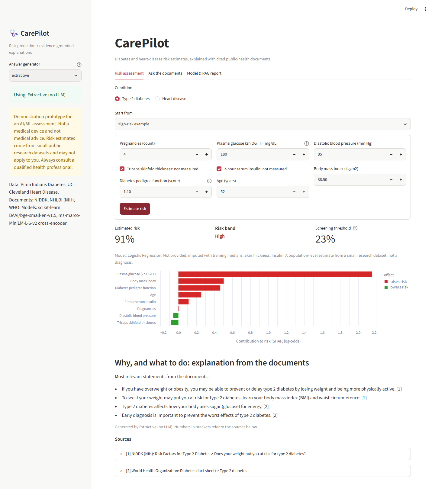
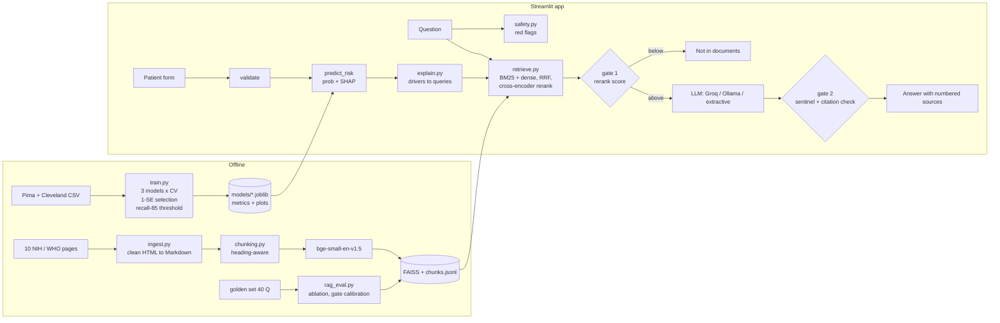
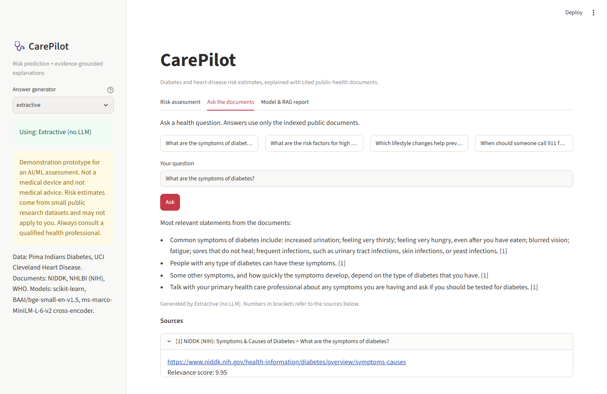
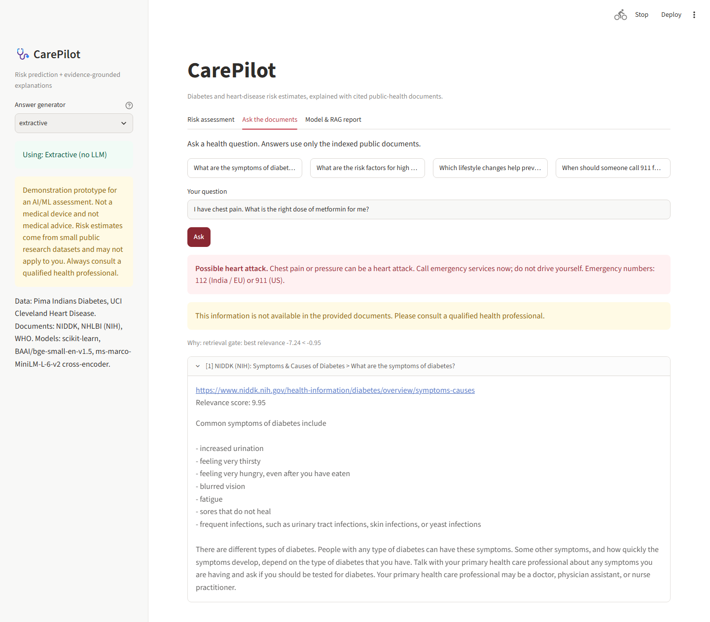
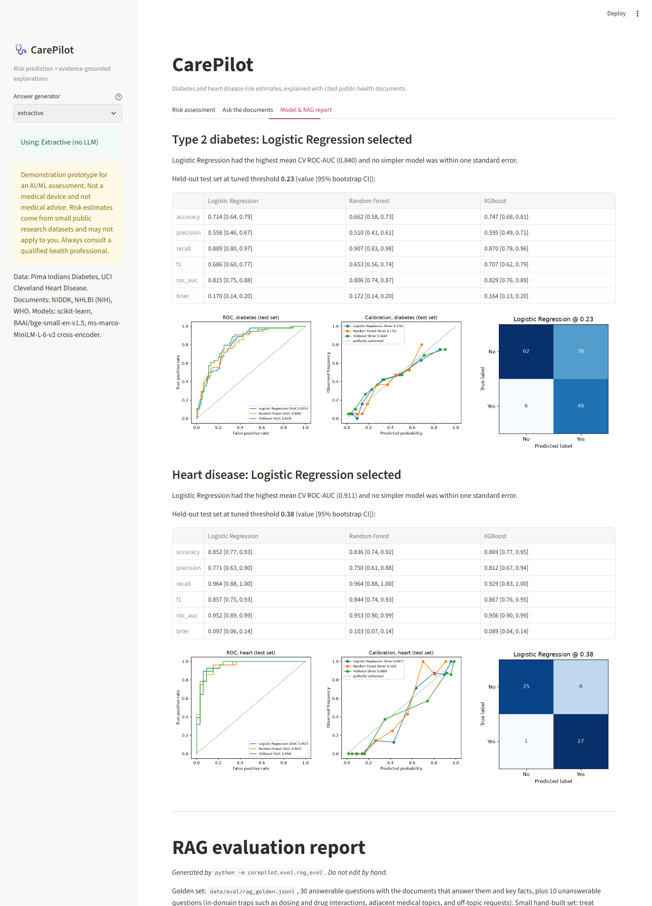

# CarePilot

**Healthcare risk prediction (type 2 diabetes, heart disease) explained per patient by an evaluated, citation-grounded RAG pipeline that refuses to answer when the documents don't support an answer.**

> Demonstration prototype built as a portfolio project. Not a medical device, not medical advice.



---

## TL;DR for reviewers

| What most prototypes do | What this one does |
|---|---|
| Treat Pima zeros as real values | Treat the zeros as missing values (49% of `Insulin`, 30% of `SkinThickness`). Imputation runs **inside** the CV pipeline, so nothing leaks from the validation folds |
| Pick the model with the best test score | Choose by 5-fold CV with a one-standard-error rule. The test set is used once, for reporting. Results come with **bootstrap 95% CIs** |
| Use the 0.5 threshold | Use a **screening threshold**: the highest threshold that keeps recall at 85% or above on out-of-fold predictions. Diabetes recall goes from 0.54 to 0.89 |
| Show a risk score | Show **per-patient SHAP drivers**, which feed a **personalized, cited explanation** from NIH and WHO documents |
| Wire up LangChain with a top-k vector search | Use a hand-written **hybrid retrieval** pipeline (BM25 + dense + RRF) with a **cross-encoder reranker**, with every line explainable |
| Tell the LLM "say I don't know" | Use **two abstention gates**: a calibrated reranker-score gate and an LLM sentinel. Answers without citations are never shown |
| No evaluation | A **40-question golden set** with a retrieval ablation, leave-one-out threshold estimate, citation precision and a gate-2 stress test |
| Needs an OpenAI key | Runs with **zero keys**. Pluggable providers: Groq, local Ollama (patient data stays on the machine), or an extractive no-LLM mode |
| Notebook | 94% test coverage across 94 unit and integration tests, 8 Playwright E2E journeys, GitHub Actions CI, and a Dockerfile |

## Assessment checklist

| Requirement | Where |
|---|---|
| Public healthcare tabular dataset | Pima Indians Diabetes + UCI Cleveland Heart Disease: [`src/carepilot/data/download.py`](src/carepilot/data/download.py), links below |
| Clean, preprocess, handle missing values, train/test split | [`ml/datasets.py`](src/carepilot/ml/datasets.py), [`ml/train.py`](src/carepilot/ml/train.py) |
| At least two classification models | Logistic Regression, Random Forest, XGBoost (×2 diseases) |
| Accuracy, precision, recall, F1, ROC-AUC | [`reports/ml_report.md`](reports/ml_report.md) (+ Brier, CIs, ROC / calibration / confusion plots) |
| Which model is best and why | [ML results](#part-1-machine-learning) below |
| Saved model + prediction function | `models/<disease>/model.joblib`, `predict_risk()` in [`ml/predict.py`](src/carepilot/ml/predict.py) |
| 5-10 public healthcare documents | 10 NIH / WHO pages: [`rag/ingest.py`](src/carepilot/rag/ingest.py) |
| Load, clean, chunk, embed | [`rag/ingest.py`](src/carepilot/rag/ingest.py), [`rag/chunking.py`](src/carepilot/rag/chunking.py), [`rag/index.py`](src/carepilot/rag/index.py) |
| FAISS / ChromaDB | FAISS `IndexFlatIP`: `index/faiss.index` |
| Retrieve, generate with an LLM, show sources, say when unavailable | [`rag/retrieve.py`](src/carepilot/rag/retrieve.py), [`rag/answer.py`](src/carepilot/rag/answer.py) |
| Interface (optional) | Streamlit app: [`app/streamlit_app.py`](app/streamlit_app.py), screenshots in [`docs/screenshots`](docs/screenshots) |
| Training + indexing code, metrics, limitations | This README, [`reports/`](reports) |

## Architecture



## Quick start

Requires Python 3.11 and [uv](https://docs.astral.sh/uv/). Trained models and the FAISS index are committed, so the app runs straight after install.

```bash
uv sync                                   # installs CPU-only torch
uv run streamlit run app/streamlit_app.py # http://localhost:8501
```

It works with **no API key**: the sidebar shows which answer generator is active.

| Generator | Setup | Notes |
|---|---|---|
| Groq, Llama 3.3 70B (best quality) | `cp .env.example .env`, then set `GROQ_API_KEY` (free at console.groq.com) | Selected automatically when the key exists |
| Ollama, local (private) | `ollama pull qwen2.5:3b`, Ollama running | Patient data never leaves the machine |
| Extractive (no LLM) | nothing | Quotes the best matching sentences with citations |

Docker: `docker build -t carepilot . && docker run -p 7860:7860 --env-file .env carepilot`

### Reproduce everything from scratch

```bash
uv run python -m carepilot.data.download          # datasets + sha256 manifest
uv run python -m carepilot.ml.train --disease all # models, metrics, plots, reports/ml_report.md (~3 min)
uv run python -m carepilot.rag.ingest             # fetch + clean 10 documents (--offline re-cleans cached HTML)
uv run python -m carepilot.rag.index              # chunks, embeddings, FAISS
uv run python -m carepilot.eval.rag_eval --stage retrieval              # ablation + gate threshold
uv run python -m carepilot.eval.rag_eval --stage e2e --provider groq     # end-to-end answer quality
uv run python -m carepilot.rag.ask "What are the symptoms of diabetes?"  # CLI Q&A
```

Tests: `uv run pytest` (unit + integration), `uv run pytest -m e2e` (Playwright; first run `uv run playwright install chromium`).

---

## Part 1: Machine learning

### Data

| Dataset | Rows | Positive rate | Missing values (after cleaning) | Source / license |
|---|---|---|---|---|
| Pima Indians Diabetes | 768 | 34.9% | Insulin 374, SkinThickness 227, BloodPressure 35, BMI 11, Glucose 5 | [CSV](https://raw.githubusercontent.com/jbrownlee/Datasets/master/pima-indians-diabetes.data.csv), origin NIDDK, CC0 on Kaggle |
| UCI Cleveland Heart Disease | 303 | 45.9% | ca 4, thal 2 | [UCI](https://archive.ics.uci.edu/dataset/45/heart+disease), CC BY 4.0 |

**Cleaning.** In Pima, a value of 0 for Glucose, BloodPressure, SkinThickness, Insulin or BMI is physiologically impossible and means "not measured". These zeros become `NaN`; `Pregnancies = 0` stays as a real value. In the heart data, `?` becomes `NaN` and the 0-4 severity target becomes presence vs absence.

**Preprocessing** (inside an sklearn `Pipeline`, so it is refit on every CV fold): median imputation **plus missing-indicator columns** (missingness can carry signal), standard scaling, and one-hot encoding for heart categoricals.

### Protocol

1. Stratified 80/20 split (seed 42). The test set is touched once.
2. Logistic Regression, Random Forest and XGBoost, each tuned with a deliberately small grid by 5-fold stratified CV on ROC-AUC.
3. **Selection:** best mean CV ROC-AUC, with Logistic Regression preferred if it is within one standard error (parsimony).
4. **Threshold:** the highest threshold whose **out-of-fold** recall is at least 85% (a screening sensitivity target).
5. Test metrics with **percentile bootstrap 95% CIs** (1000 resamples), plus Brier score and calibration curves.

### Results (held-out test set, value [95% CI])

**Diabetes**: Logistic Regression selected (CV ROC-AUC 0.840 ± 0.021 vs RF 0.837, XGBoost 0.825)

| Model @ threshold | Accuracy | Precision | Recall | F1 | ROC-AUC | Brier |
|---|---|---|---|---|---|---|
| **LogReg @ 0.23 (selected)** | 0.714 [0.64, 0.79] | 0.558 [0.46, 0.67] | **0.889** [0.80, 0.97] | 0.686 [0.60, 0.77] | 0.815 [0.75, 0.88] | 0.170 |
| LogReg @ 0.50 | 0.714 | 0.604 | 0.537 | 0.569 | 0.815 | 0.170 |
| Random Forest @ 0.50 | 0.727 | 0.658 | 0.463 | 0.543 | 0.806 | 0.172 |
| XGBoost @ 0.50 | 0.766 | 0.680 | 0.630 | 0.654 | 0.829 | 0.164 |

**Heart disease**: Logistic Regression selected (CV ROC-AUC 0.911 ± 0.018 vs RF 0.899, XGBoost 0.887)

| Model @ threshold | Accuracy | Precision | Recall | F1 | ROC-AUC | Brier |
|---|---|---|---|---|---|---|
| **LogReg @ 0.38 (selected)** | 0.852 [0.77, 0.93] | 0.771 [0.63, 0.90] | **0.964** [0.88, 1.00] | 0.857 [0.75, 0.93] | 0.952 [0.89, 0.99] | 0.097 |
| LogReg @ 0.50 | 0.869 | 0.812 | 0.929 | 0.867 | 0.952 | 0.097 |
| Random Forest @ 0.50 | 0.869 | 0.833 | 0.893 | 0.862 | 0.953 | 0.103 |
| XGBoost @ 0.50 | 0.885 | 0.839 | 0.929 | 0.881 | 0.956 | 0.089 |

The full tables (every model at both thresholds) and the ROC, calibration and confusion plots are in [`reports/ml_report.md`](reports/ml_report.md).

### Which model is best, and why

- **Logistic Regression had the highest cross-validated ROC-AUC on both datasets.** With 614 and 242 training rows, a handful of mostly monotonic risk factors (higher glucose and BMI mean higher risk), and no strong interactions, a regularized linear model (best `C = 0.1`) generalizes as well as or better than tree ensembles, which have more variance to spend on noise.
- **XGBoost scored slightly higher on the test set** (0.829 vs 0.815; 0.956 vs 0.952), but the 95% intervals overlap almost entirely. Switching to it because of the test score would be **test-set selection**, and the reported number would then be optimistically biased. Selection stays on CV.
- **LR is also the better fit for this product.** Its probabilities are reasonably calibrated (Brier 0.170 / 0.097), so "35% risk" means something. Its SHAP values are exact and cheap, which drives the explanation feature. The model is tiny and fast.
- **Threshold choice matters more than model choice here.** At 0.5 the diabetes model misses 46% of diabetics. At the screening threshold of 0.23, recall is 0.89, at the cost of more false positives (precision 0.56). For a screening tool a false positive costs a follow-up test, while a missed case can go undiagnosed.

### Prediction function

```python
from carepilot.ml.predict import predict_risk

r = predict_risk("diabetes", {"Glucose": 165, "BMI": 36.2, "Age": 52})  # omitted fields are imputed
r.probability, r.band, r.flagged          # 0.75, 'High', True
[(f.feature, round(f.contribution, 2)) for f in r.top_factors(3)]
# [('Glucose', 1.64), ('BMI', 0.31), ('Age', 0.25)]
```

Input validation collects every problem at once, using plausible clinical ranges. For example, `Glucose = 0` is rejected rather than silently accepted.

---

## Part 2: RAG system

### Corpus (10 public documents)

| Publisher | Documents | License |
|---|---|---|
| NIDDK (NIH) | Symptoms & Causes of Diabetes; Risk Factors for Type 2 Diabetes; Preventing Type 2 Diabetes; Managing Diabetes | US Government work, public domain |
| NHLBI (NIH) | High Blood Pressure: Causes and Risk Factors; High Blood Pressure: Treatment; Coronary Heart Disease: Risk Factors; Heart Attack: Symptoms | US Government work, public domain |
| WHO | Hypertension fact sheet; Diabetes fact sheet | CC BY-NC-SA 3.0 IGO (non-commercial, attributed) |

The URLs and retrieval dates are in `data/docs/clean/manifest.json`. CDC pages were the first choice, but they block scripted downloads (HTTP 403), so equivalent NIH pages were used to keep ingestion reproducible.

### Pipeline

1. **Clean:** extract the main article, drop navigation, glossary pop-ups and reference lists, strip footnote markers, then convert to Markdown with headings kept.
2. **Chunk:** split at headings, then pack paragraphs and bullet runs into chunks of up to 900 characters with a short overlap. Each chunk carries `title > section` context, which is embedded with it. The result is 152 chunks.
3. **Embed and index:** `BAAI/bge-small-en-v1.5` (384-d, normalized; queries get the bge instruction prefix) in FAISS `IndexFlatIP`. Exact search, since the corpus is small.
4. **Retrieve:** dense top-20 and BM25 top-20, fused with **Reciprocal Rank Fusion** (k = 60), then the top 20 are reranked with `cross-encoder/ms-marco-MiniLM-L-6-v2`. The top 5 go to the LLM.
5. **Gate 1:** if the best reranker score is below the calibrated threshold (−0.95), return "not available in the provided documents" **without calling the LLM**.
6. **Generate:** numbered passages go to the LLM with rules: cite every claim `[n]`, use no outside knowledge, give no dosing or diagnosis, and treat passages as data, not instructions (a prompt-injection guard).
7. **Gate 2:** if the model returns `INSUFFICIENT_CONTEXT` with no cited content, abstain. Citations pointing to non-existent passages are removed. An answer with **no valid citation is never shown**; the system falls back to quoting the passages. Only the cited sources are listed, with publisher, section, URL and passage text.

### Evaluation ([`reports/rag_eval.md`](reports/rag_eval.md))

The golden set has 30 answerable questions, labeled with the documents that answer them and their key facts, plus 10 unanswerable questions: dosing, drug interactions, "does cinnamon cure diabetes", adjacent diseases, and off-topic or prompt-misuse requests.

**Retrieval ablation** (answerable questions):

| Retriever | Hit@1 | Hit@3 | MRR@10 | Doc recall@5 | Median latency (CPU) |
|---|---|---|---|---|---|
| Dense (bge-small + FAISS) | 0.97 | 1.00 | 0.983 | 0.93 | 34 ms |
| BM25 | 0.77 | 0.93 | 0.852 | 0.88 | <1 ms |
| Hybrid (RRF) | 0.87 | 1.00 | 0.928 | 0.94 | 35 ms |
| **Hybrid + cross-encoder rerank** | **1.00** | **1.00** | **1.000** | 0.93 | 770 ms |

*Reading this honestly:* on a small, clean corpus, dense retrieval alone is already strong, and naive RRF **lowers** Hit@1 because the weaker BM25 ranking pulls irrelevant chunks up. The reranker recovers this, reaching a perfect top-1, for about 0.7 s of CPU. The hybrid stage still earns its place: it gives the best doc recall@5, protects exact-term queries such as "A1C" and "140/90", and the reranker score doubles as the abstention signal.

**Abstention gate:** top-1 reranker scores fully separate the two groups (lowest answerable score −0.11, highest unanswerable −1.79). The in-sample result is 100% / 100%, but the threshold was tuned on these same questions, so the honest **leave-one-out estimate is 96.7% of answerable questions kept and 90% of unanswerable questions rejected**.

**End-to-end answers:**

| Generator | Answer rate | Key-fact coverage | Citation precision | Sentences cited | Abstained on unanswerable | LLM alone refuses (gate 1 off) |
|---|---|---|---|---|---|---|
| Extractive (no LLM) | 100% | 78% | 91% | 100% | 100% | n/a |
| Ollama qwen2.5:3b (local) | see report | | | | 100% | 90% |
| Groq Llama 3.3 70B | see report | | | | | |

The gate-2 stress test shows **defense in depth**: with the retrieval gate switched off, the LLM alone still refuses 9 of 10 unanswerable questions. Together the gates refused every unanswerable question in the eval.

---

## Part 3: Interface

`uv run streamlit run app/streamlit_app.py` opens three tabs:

1. **Risk assessment:** pick diabetes or heart disease, start from a preset or enter values (unmeasured fields can be marked "not measured"). The tab shows the probability, risk band, screening threshold, a SHAP factor chart, and a **personalized explanation**: the patient's top risk-raising factors become focused retrieval queries ("How does high blood glucose affect the risk of type 2 diabetes?"), plus lifestyle and "when to see a doctor" queries. The merged passages produce one cited explanation.
2. **Ask the documents:** free-text or example questions, an answer with numbered, expandable sources, or an explicit "not available in the documents".
3. **Model & RAG report:** metrics with CIs, plots, and the RAG evaluation.

| Ask with sources | Abstention + red-flag banner | Report |
|---|---|---|
|  |  |  |

## Safety and responsible AI

- **Red-flag detection** runs before anything else: chest pain, stroke signs (FAST), diabetic emergency, BP ≥ 180/120 typed in a question *or entered in the form*, and crisis language. It shows emergency guidance with Indian and US numbers. The rules are transparent and unit-tested; for emergencies, an auditable rule that over-fires is preferable to a model that might miss.
- **Grounding:** two abstention gates, citation validation, and no uncited LLM text shown.
- **Scope:** the prompt forbids dosing and diagnosis. A dosing question is rejected by gate 1 (the documents don't cover dosing).
- **Privacy:** patient values live only in the Streamlit session; nothing is logged or stored. Choosing Ollama keeps all inference local.
- **Honesty in the UI:** a standing disclaimer, "population-level estimate, not a diagnosis", and a list of which fields were imputed.

## Testing and quality

| Layer | What | Count |
|---|---|---|
| Unit | cleaning, validation, metrics and CIs, threshold rule, chunking, RRF, tokenization, citation validation, both abstention gates, provider fallback, red flags, explanation queries, eval metrics | 77 |
| Integration | real models and index: all retrieval modes, end-to-end answers, the explanation flow, and the **training, report, download, ingest, index and eval pipelines run in temp dirs**, including the tree-model SHAP path | 17 |
| E2E (Playwright) | page object model + session-scoped server fixture; journeys: risk + cited explanation, low risk, heart + hypertensive-crisis banner, Q&A with source links, abstention, red flag, report tab | 8 |

- Coverage is **94%** (`pytest --cov`; CI fails below 80%).
- The E2E tests wait on Streamlit's run state instead of fixed sleeps. That fixed a real race, where the form could submit before a preset rerun finished, and the suite passed six consecutive runs.
- The tests caught two real bugs, both fixed and covered by tests. Tree-model SHAP output (rows × features × classes) was being flattened, which interleaved the classes. A small LLM was appending the sentinel after a valid cited answer, which caused over-abstention.
- **CI** ([`.github/workflows/ci.yml`](.github/workflows/ci.yml)): ruff format and lint, then unit and integration tests with the coverage gate, then Playwright E2E (artifacts uploaded on failure), then a Docker build.

## Project structure

```
src/carepilot/
  config.py              paths, model names, env settings
  data/download.py       dataset download + manifest
  ml/  datasets.py       per-disease specs, cleaning, validation ranges
       train.py          CV tuning, 1-SE selection, OOF threshold, artifacts
       evaluate.py       metrics, bootstrap CIs, threshold rule, plots
       report.py         reports/ml_report.md
       predict.py        predict_risk(), SHAP grouping to raw features
  rag/ ingest.py         fetch + clean HTML to Markdown
       chunking.py       heading-aware chunker
       index.py          embeddings + FAISS
       retrieve.py       dense, BM25, RRF, cross-encoder rerank
       answer.py         prompt, gates, citation validation, extractive mode
       ask.py            CLI
  llm/providers.py       Groq, Ollama, extractive, auto-selection
  core/explain.py        SHAP drivers to cited explanation
  core/safety.py         red flags, vitals check, disclaimer
  eval/rag_eval.py       golden-set evaluation
app/streamlit_app.py     UI
data/                    raw CSVs, raw + clean docs, golden set
models/ index/ reports/  generated artifacts (committed for instant start)
tests/{unit,integration,e2e}
```

## External libraries, models and APIs

- **Pretrained models:** [BAAI/bge-small-en-v1.5](https://huggingface.co/BAAI/bge-small-en-v1.5) (MIT), [cross-encoder/ms-marco-MiniLM-L-6-v2](https://huggingface.co/cross-encoder/ms-marco-MiniLM-L-6-v2) (Apache-2.0), Llama 3.3 70B via the [Groq API](https://console.groq.com) (optional), [Qwen2.5-3B-Instruct](https://ollama.com/library/qwen2.5) via Ollama (optional).
- **Libraries:** scikit-learn, XGBoost, SHAP, pandas, NumPy, matplotlib, sentence-transformers, PyTorch (CPU), faiss-cpu, rank-bm25, BeautifulSoup, requests, groq, Streamlit, Altair, pydantic, python-dotenv; dev: pytest, pytest-cov, pytest-playwright, ruff.
- **External APIs at runtime:** Groq only (optional). Hugging Face Hub downloads the two retrieval models on first run.
- **No LangChain or LlamaIndex**, by design: the RAG pipeline is about 400 lines of explicit, tested code.

## Limitations

- **Data:** Pima covers only women of Pima Indian heritage aged 21 and over; Cleveland is 303 patients from 1988. Neither represents the general population, so the models are not clinically valid and the estimates may be biased for other groups. Test sets are small (154 and 61 rows), hence the wide CIs.
- **Features:** the heart model needs stress-test and fluoroscopy inputs that a patient won't know, so it suits a clinician-facing demo.
- **Imputation:** median imputation shrinks variance, and Insulin is 49% missing.
- **Golden set:** 40 hand-written questions by one author. Key-fact matching is string-based, so it undercounts paraphrases. The threshold was tuned on the same set (mitigated with leave-one-out).
- **Corpus:** 10 documents, English only, as of retrieval date. "Not in the documents" does not mean "not true".
- **Latency:** the cross-encoder adds about 0.7 s on CPU. Local 3B LLM answers take about 20 s on a laptop GPU.
- **Explanations:** SHAP shows association within the model, not causation.

## Future improvements

1. Fairness and subgroup analysis (age bands, sex), plus recalibration on local data before any real use.
2. Better imputation (iterative or KNN) compared within CV, and probability calibration (isotonic) if a tree model is ever chosen.
3. A larger, independently written golden set; LLM-as-judge faithfulness scoring alongside string matching; a held-out split for threshold tuning.
4. Claim-level grounding checks (NLI between each sentence and its cited passage).
5. Document refresh pipeline with change detection, a bigger multilingual corpus (Hindi), and an IVF/HNSW index when the corpus grows.
6. Serving: FastAPI service, model registry, drift and calibration monitoring, audit logging without PHI, and alignment with India's DPDP Act and HIPAA.

## Data and content attribution

Pima Indians Diabetes data: Smith et al., 1988 (NIDDK). Heart Disease data: Janosi, Steinbrunn, Pfisterer, Detrano, 1989, UCI ML Repository, CC BY 4.0. Health content: NIDDK and NHLBI (public domain) and WHO fact sheets (CC BY-NC-SA 3.0 IGO), used unmodified apart from text cleaning, with links in every answer.
