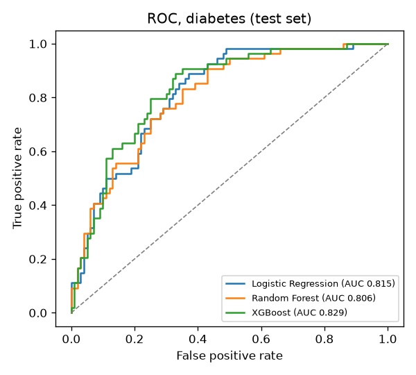
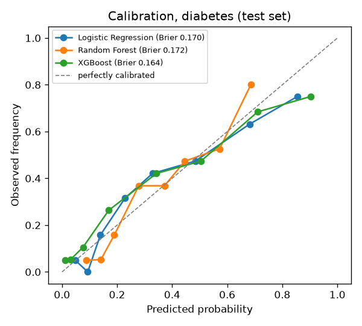
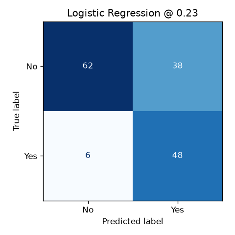
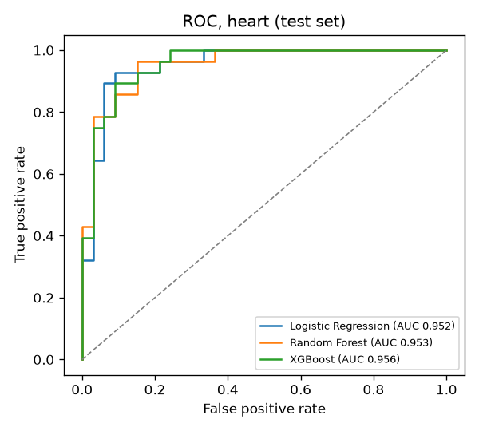
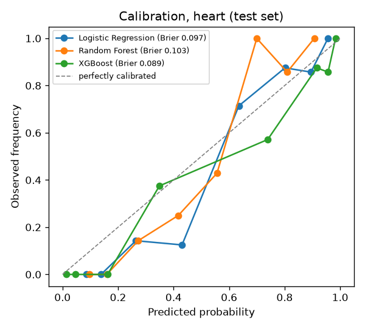
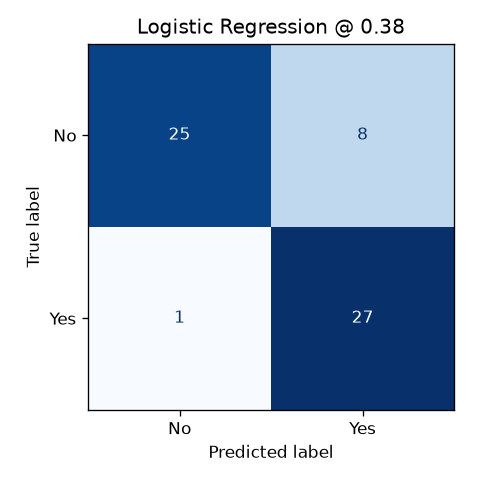

# ML model report

_Generated by `python -m carepilot.ml.train`. Do not edit by hand._

Confidence intervals: percentile bootstrap, 1000 resamples of the test set. Small test sets give wide intervals; differences between models whose intervals overlap heavily are not conclusive.

## Type 2 diabetes (Pima Indians Diabetes dataset)

Train 614 / test 154 rows, positive rate 34.9%.

### Cross-validation on the training set (model selection)
| Model | CV ROC-AUC (mean +/- sd, 5-fold) | Best params |
|---|---|---|
| Logistic Regression | 0.840 +/- 0.021 | C=0.1 |
| Random Forest | 0.837 +/- 0.016 | max_depth=4, min_samples_leaf=1 |
| XGBoost | 0.825 +/- 0.024 | max_depth=2, min_child_weight=1 |

### Held-out test set at default threshold 0.50 (value [95% bootstrap CI])
| Metric | Logistic Regression | Random Forest | XGBoost |
|---|---|---|---|
| Accuracy | 0.714 [0.65, 0.78] | 0.727 [0.66, 0.79] | 0.766 [0.70, 0.83] |
| Precision | 0.604 [0.46, 0.74] | 0.658 [0.50, 0.81] | 0.680 [0.55, 0.80] |
| Recall | 0.537 [0.40, 0.68] | 0.463 [0.32, 0.61] | 0.630 [0.49, 0.77] |
| F1 | 0.569 [0.45, 0.68] | 0.543 [0.41, 0.66] | 0.654 [0.54, 0.75] |
| ROC-AUC | 0.815 [0.75, 0.88] | 0.806 [0.74, 0.87] | 0.829 [0.76, 0.89] |
| Brier (lower better) | 0.170 [0.14, 0.20] | 0.172 [0.14, 0.20] | 0.164 [0.13, 0.20] |

### Held-out test set at tuned threshold 0.23
| Metric | Logistic Regression | Random Forest | XGBoost |
|---|---|---|---|
| Accuracy | 0.714 [0.64, 0.79] | 0.662 [0.58, 0.73] | 0.747 [0.68, 0.81] |
| Precision | 0.558 [0.46, 0.67] | 0.510 [0.41, 0.61] | 0.595 [0.49, 0.71] |
| Recall | 0.889 [0.80, 0.97] | 0.907 [0.83, 0.98] | 0.870 [0.78, 0.96] |
| F1 | 0.686 [0.60, 0.77] | 0.653 [0.56, 0.74] | 0.707 [0.62, 0.79] |
| ROC-AUC | 0.815 [0.75, 0.88] | 0.806 [0.74, 0.87] | 0.829 [0.76, 0.89] |
| Brier (lower better) | 0.170 [0.14, 0.20] | 0.172 [0.14, 0.20] | 0.164 [0.13, 0.20] |

**Selected model: Logistic Regression.** Logistic Regression had the highest mean CV ROC-AUC (0.840) and no simpler model was within one standard error.

XGBoost scores slightly higher ROC-AUC on the test set (0.829 vs 0.815), but the 95% intervals overlap almost completely ([0.76, 0.89] vs [0.75, 0.88]). The test set is used only to report, never to choose: picking the winner on the test set would make its score an optimistic, selection-biased estimate.

At the tuned threshold the selected model catches 89% of positive
cases (recall) with precision 56%. Threshold rule:
highest threshold with recall >= 85% on 5-fold out-of-fold training predictions (screening sensitivity target).

| ROC | Calibration | Confusion matrix |
|---|---|---|
|  |  |  |

## Coronary heart disease (UCI Cleveland dataset)

Train 242 / test 61 rows, positive rate 45.9%.

### Cross-validation on the training set (model selection)
| Model | CV ROC-AUC (mean +/- sd, 5-fold) | Best params |
|---|---|---|
| Logistic Regression | 0.911 +/- 0.018 | C=0.1 |
| Random Forest | 0.899 +/- 0.024 | max_depth=4, min_samples_leaf=1 |
| XGBoost | 0.887 +/- 0.026 | max_depth=3, min_child_weight=5 |

### Held-out test set at default threshold 0.50 (value [95% bootstrap CI])
| Metric | Logistic Regression | Random Forest | XGBoost |
|---|---|---|---|
| Accuracy | 0.869 [0.77, 0.93] | 0.869 [0.79, 0.93] | 0.885 [0.80, 0.95] |
| Precision | 0.812 [0.67, 0.93] | 0.833 [0.69, 0.96] | 0.839 [0.69, 0.96] |
| Recall | 0.929 [0.83, 1.00] | 0.893 [0.77, 1.00] | 0.929 [0.83, 1.00] |
| F1 | 0.867 [0.76, 0.94] | 0.862 [0.76, 0.94] | 0.881 [0.78, 0.95] |
| ROC-AUC | 0.952 [0.89, 0.99] | 0.953 [0.90, 0.99] | 0.956 [0.90, 0.99] |
| Brier (lower better) | 0.097 [0.06, 0.14] | 0.103 [0.07, 0.14] | 0.089 [0.04, 0.14] |

### Held-out test set at tuned threshold 0.38
| Metric | Logistic Regression | Random Forest | XGBoost |
|---|---|---|---|
| Accuracy | 0.852 [0.77, 0.93] | 0.836 [0.74, 0.92] | 0.869 [0.77, 0.95] |
| Precision | 0.771 [0.63, 0.90] | 0.750 [0.61, 0.88] | 0.812 [0.67, 0.94] |
| Recall | 0.964 [0.88, 1.00] | 0.964 [0.88, 1.00] | 0.929 [0.83, 1.00] |
| F1 | 0.857 [0.75, 0.93] | 0.844 [0.74, 0.93] | 0.867 [0.76, 0.95] |
| ROC-AUC | 0.952 [0.89, 0.99] | 0.953 [0.90, 0.99] | 0.956 [0.90, 0.99] |
| Brier (lower better) | 0.097 [0.06, 0.14] | 0.103 [0.07, 0.14] | 0.089 [0.04, 0.14] |

**Selected model: Logistic Regression.** Logistic Regression had the highest mean CV ROC-AUC (0.911) and no simpler model was within one standard error.

XGBoost scores slightly higher ROC-AUC on the test set (0.956 vs 0.952), but the 95% intervals overlap almost completely ([0.90, 0.99] vs [0.89, 0.99]). The test set is used only to report, never to choose: picking the winner on the test set would make its score an optimistic, selection-biased estimate.

At the tuned threshold the selected model catches 96% of positive
cases (recall) with precision 77%. Threshold rule:
highest threshold with recall >= 85% on 5-fold out-of-fold training predictions (screening sensitivity target).

| ROC | Calibration | Confusion matrix |
|---|---|---|
|  |  |  |
